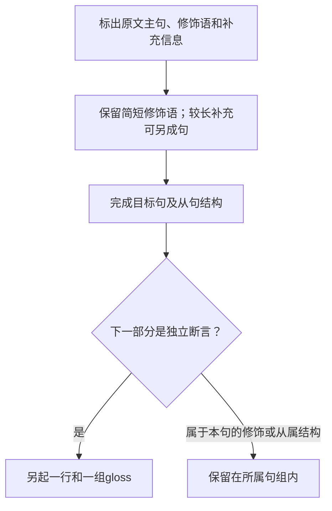

# 输出规范

用于译文、gloss 和对齐 PDF。[返回主流程](../SKILL.md)。

## Deliver the requested result

- 逐句排列，**原文在上，译文在下**；保留原文措辞与顺序。长文编号，南北版本分开。
- 从土家语译出时保留原文记音，并给出目标语言译文。
- 译入土家语的普通逐句译文在所有检索模式下统一：**默认调号拼音（只用这一行）；用户要 IPA 时只用 IPA**。只有用户明确要求调号拼音 + IPA 时才并列。叶氏拼音也仅在用户明确要求时使用。
- 汉语说明统一称“汉语”。按所选记音交付，不因检索方式增加另一行记音。

```text
(1) 原文：〈源语言原文〉
    译文：〈目标语言译文〉
```

## Optional word-by-word gloss and aligned PDF

用户明确要求gloss或PDF时直接制作；尚未说明偏好时，交付译文后主动询问一次是否需要逐词 gloss 或对齐 PDF，继续完成翻译。

gloss 释义按用户要求选语言；未指定时用本次翻译的非土家语语言，文献引例保留原貌。需要 gloss 时，将完整原文放在上方，下方固定按 **拼音 → IPA → gloss** 三行逐词对齐：拼音在上、IPA 在中间、gloss 在下；不再重复整句译文。示例（Brassett 等 2006:101，例70）：

(1) 我要小的。

| *ngá* | *bíkuī* | *dì* |
| --- | --- | --- |
| ŋa²⁴ | pi²⁴kʰuei⁵⁵ | ti⁵¹ |
| 我 | 小的 | 要 |

- 每列对应一个词，词内按网站形态分析用“-”连接动词变位与名物化成分，各行保持相同边界。gloss 标实际词义与语法功能，标签简短，意译和疑点集中注释。
- PDF 采用黑白论文式版面：衬线字体、连续例句编号、页码，无框线、无底纹；拼音斜体，IPA 与 gloss 正体。
- **逐句分组、每句另起行。** 先按句号、问号、叹号或诗歌原有行界拆句；每句原文单独编号，其下另起一个完整的拼音／IPA／gloss 三行对齐组。一个段落含多句时逐句拆开，引语中的每句也单独处理；下一句从新行开始。长句可在本句组内按词／词素列续行，续行仍完整显示三层并保持词界；每个续行组整体移页。
- 文言或复句按独立断言或完整主句划分对齐组，结合独立谓语和语义关系判断边界，逗号、分号及连接词都可提示分句。例如“哥哥劈柴，姐姐缝衣，我捆柴”，可按「哥哥劈柴／姐姐缝衣／我捆柴」分组，各小句单独起行；名词短语内部的停顿仍留在同组。
- 各行左对齐，列宽容纳该列最长内容；保持正文可读字号，按词界续行，不用缩小整句字号来强塞一行。
- 保存并关闭 PDF 后，在新进程中重新打开并逐页检查汉字、声调、IPA 和对齐。字体映射异常时先完整嵌入字体；仍失败则从正确显示的源文件转成矢量轮廓再检查。

## 语法标签用英文缩写

分词采用网站标准：独立词用空格，动词变位与名物化的可切分成分用“-”连接，后缀链保留逐级边界。拼音、IPA、gloss三行使用相同边界；一列对应一个词，词内用“-”标词素。具体规则见[词界](notation-audit.md#word-boundaries)。

新生成的gloss中，**实词按词义释义；所有虚词、格助词、动词变位及名物化等语法成分用英文大写缩写**。缩写仅从下表选取；同一功能采用表中固定标签。来源使用其他缩写时，新生成gloss按本表统一，原文分析留在来源记录中。扩充类别属于单独的规则维护；翻译任务按现有表执行。

存在谓语、系词、代词和量词统一按实词释义，写“有、没有、是、我、他、根”等。能愿形式也按下面的整体成分表使用词义释义。

<!-- fixed-gloss-labels:start -->
| 缩写 | 英文全称 | 汉语意义 |
| --- | --- | --- |
| PFV | perfective | 完整体 |
| PRF | perfect | 完成体／事后状态 |
| COMPL | completive | 完结 |
| PROG | progressive | 进行 |
| STAT | stative | 状态 |
| DUR | durative | 持续 |
| CONT | continuative | 延续 |
| EXP | experiential | 经历 |
| INCH | inchoative | 起始／新情况 |
| IRR | irrealis | 未然 |
| PROSP | prospective | 预期 |
| FUT | future | 将来 |
| NEG | negation | 否定 |
| PROH | prohibitive | 禁止 |
| IMP | imperative | 祈使 |
| Q | question | 疑问 |
| NMLZ | nominalizer | 名物化 |
| LNK | linker | 修饰连接 |
| ADVZ | adverbializer | 方式化 |
| CONN | connective | 小句连接；先后或转折关系写在整句释义 |
| TOP | topic | 话题 |
| FOC | focus | 焦点 |
| GEN | genitive | 领属 |
| LOC | locative | 处所格 |
| DAT | dative | 与格 |
| BEN | benefactive | 受益 |
| ERG | ergative | 作格 |
| ACC | accusative | 宾格 |
| ABL | ablative | 离格 |
| ALL | allative | 向格 |
| INS | instrumental | 工具格 |
| COM | comitative | 伴随格 |
| DIR | directional | 方向 |
| VEN | venitive | 向心 |
| AND | andative | 离心 |
| IMM | immediate | 即时性 |
| CAUS | causative | 使役 |
| SG | singular | 单数 |
| PL | plural | 复数 |
<!-- fixed-gloss-labels:end -->

复合标签只组合表内已有标签，同一未切分成分的多项功能用“.”，如DIR.IMM；可切分成分按“-”分别对齐。连接成分统一用CONN，先后、转折等具体关系放在整句释义。交付只摘列实际用到的标签及本表定义。

<a id="modal-components"></a>

### 能愿与程度成分：整体处理

**所有能愿形式各作为一个成分，内部连写，gloss用整体词义。** 否定成分单独切分并标NEG，能愿部分保持整体；否定在前写NEG-能愿词义，否定在后写能愿词义-NEG。同一谓语中的其他独立成分保留自己的边界；动词与能愿成分之间按网站词界连接，三行同步。

唯一单列的xige构式写成“［前面的谓语结构］-xi ge”：xi附着前面的结构并标NMLZ，ge另列，释义“怕”。按已选来源记音；下表省略声调仅用于识别成分，不替代实际译句的记音。

| 形式／来源音形 | gloss | 能愿类型与选用条件 |
| --- | --- | --- |
| dexi /tɤ ɕi/ | 能／可以 | 一般能力、条件可行；许可语境可表获准 |
| doxi /to ɕi/ | 做得／能 | 来源中的一般能力形式 |
| gaxi /ka ɕi/ | 可以／得行 | 许可或条件容许 |
| /ɣɤ/ | 会／擅长 | 掌握做法、熟练 |
| /tsʰɿ-ɣɤ/ | NEG-会／NEG-擅长 | 技能或熟练程度不足 |
| /tsʰɤ/（体力义） | 做得动 | 体力足够 |
| /xɨ-tsʰɤ/ | NEG-做得动 | 体力不足 |
| /pie/ | 有空／来得及 | 时间条件允许 |
| /tʰa-pie/ | NEG-有空／NEG-来得及 | 时间不足 |
| /tʰa-tʰi/ | NEG-能 | 一般能力或条件不允许 |
| /tʰa-tʰiu/ | NEG-能 | 能力或条件已不再允许 |
| /tsʰai ɲie/ | 还做得起 | 来源中能力仍保持的形式 |
| /tuɔ/ | 必须／需要 | 必要性 |
| /tʰa-tuɔ/ | NEG-需要／NEG-可以 | 按上下文区分必要性否定与禁止 |
| /tʰi ɕi/ | 必须／只能 | 必要性或选择受限 |
| /tsʰa/ | 想 | 意愿 |
| /tsʰa-ta/ | 想-NEG | 意愿否定 |
| /tsʰɤ/（意愿义） | 愿意 | 主观意愿 |
| /tʰa-tsʰɤ/ | NEG-愿意 | 意愿否定 |

形式与意义依据[north-4能愿专题](aspect-modality.md#ability)及各分节；保留调查点与来源的搭配条件。xige的拆分见[推测](aspect-modality.md#ability)。同形的体力义与意愿义按上下文区分。

xitai同样作为一个程度成分，内部连写，gloss为“很／太”。

标注示例（示意词素关系）：

| 成分组合 | 汉语gloss |
| --- | --- |
| 我＋领属助词＋衣服 | 我 GEN 衣服 |
| 动词＋完整体变位 | 词义-PFV |
| 动词＋完整体变位＋名物化 | 词义-PFV-NMLZ |
| 独立禁止助词＋动词 | PROH 词义 |

交付前逐词扫描：所有虚词、格助词和变位、名物化等语法成分均已用英文缩写；同一功能标签一致；全部标签均见固定缩写表；运行`python3 scripts/check_gloss_labels.py <gloss.json>`核对表外标签；词素边界三行对应。祈使语气IMP按实际承载层级记录，裸谓语的整句语气可写入句级说明。

按[Leipzig Glossing Rules](https://www.eva.mpg.de/lingua/resources/glossing-rules.php)对齐：词素切分两侧对应用“-”，附着词用“=”，同一未切分成分表达多个标签时用“.”，如GEN.PL。复核时逐列检查标签、边界和作用范围。

## 原文与目标小句的对应及换行

<a id="clause-layout-choice"></a>

先按[复杂句拆解](translation-decisions.md#complex-sentence-breakdown)保留简短从句、分出较长补充，再为每个目标主句排gloss。一个原文句子可以对应多个目标句，一个目标句可以包含从句。



按谓语间实际关系判断连接；PFV lie 标记前一事件，小句关系见[lie／mo流程](translation-decisions.md#lie-mo-choice)。同一主语省略后，仍按本流程判断小句边界。


- 独立主谓或主谓宾结构结束后，后续若是另一独立断言、两者之间没有显式连接词或已选定的连动／从属构式，就新起一行。省略同一主语的小句也按此判断。
- 名词短语内部的定语、关系从句，以及一个谓语内部的体貌、情态和否定成分，与所属结构放在同一组。
- 有显式连接词或明确连动、从属关系时可保留同组；较长时按主句边界换组，保持连接词归属。仅作PFV的lie算前一谓语的体标记，后句边界按两句实际关系判断。
- 每个独立目标主句另起一组“拼音→IPA→gloss”。原文显示一次；同一原文下的多组按1a、1b等编号，保留阅读顺序。
- 宽度引起的词列续行与句法换行分别处理：先定小句边界，再在该小句内部按完整词界续行。

例如一条原文“他捆好了柴，阿爸还在割草”，可以对应：

```text
(1) 原文：他捆好了柴，阿爸还在割草。
(1a) ［他＋柴＋捆好＋体貌］
      ［对应IPA］
      ［对应gloss］

(1b) ［阿爸＋草＋割＋进行＋持续］
      ［对应IPA］
      ［对应gloss］
```

结构化输出将每条原文的多个目标小句放在 `target_units` 数组中；每组独立保存 `translation`、`tokens` 和小句间关系。这样正文与gloss由相同词元、相同边界生成。


## Source-aligned transcription

自主加入、没有词典词条的汉语词保留汉字，IPA行对应位置留空；结构化字段用null。有据的土家语后缀按词界规则保留，汉语词根的读音位置留空。词典已有的借词保留所选词条记音。例如遇到词库未收录的地名“青石镇”，拼音行保留“青石镇”，IPA对应位置留空。

记音依据见[记音核验](notation-audit.md)。拼音与 IPA 按同一见证配对；采用[本站统一 IPA 记号](notation-audit.md#本站统一-ipa-记号)，保留来源调值、音节界和无调成分。所选记音缺证据时局部标“读音待核”，其余部分照常交付。

引用保留原记音；规则派生形式与原例分开记录。IPA 沿用引用调时注明“来源基记”；连读实现未核时集中说明。未然 `-i` 的边界与合音按[谓词合音](grammar-index.md)处理。详细记录存入[证据包](evidence-pack.md)。

没有固定声调的词缀、格助词允许无调书写；文献原例保留原始记音。叶式拼音仅在用户明确要求时另交。

## 说明与审校

- 先完成译文。仅在实质改写、借用或未决歧义影响理解时用一条总注说明具体处理；缺口处理见[改写与借用](evidence-pack.md)。证据检索不等于母语者审校。
- 持续工作时给出已查得的词／构式和可用译句。交付说明按实际执行标“检索模式：Embedding／Skill-based／Mixed”；Embedding 以当前推理成功为准，未取得证据时如实说明。
- 用户要求审校时，按词汇、句法、形态及意义分别指出问题、依据和修正。检索分数与逐项日志仅在要求时展示，遵循[证据规则](evidence-pack.md)。PDF 保留方言、来源及必要语言注释，执行过程留在交付说明中。
