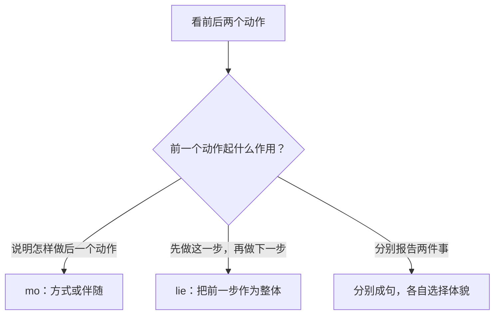
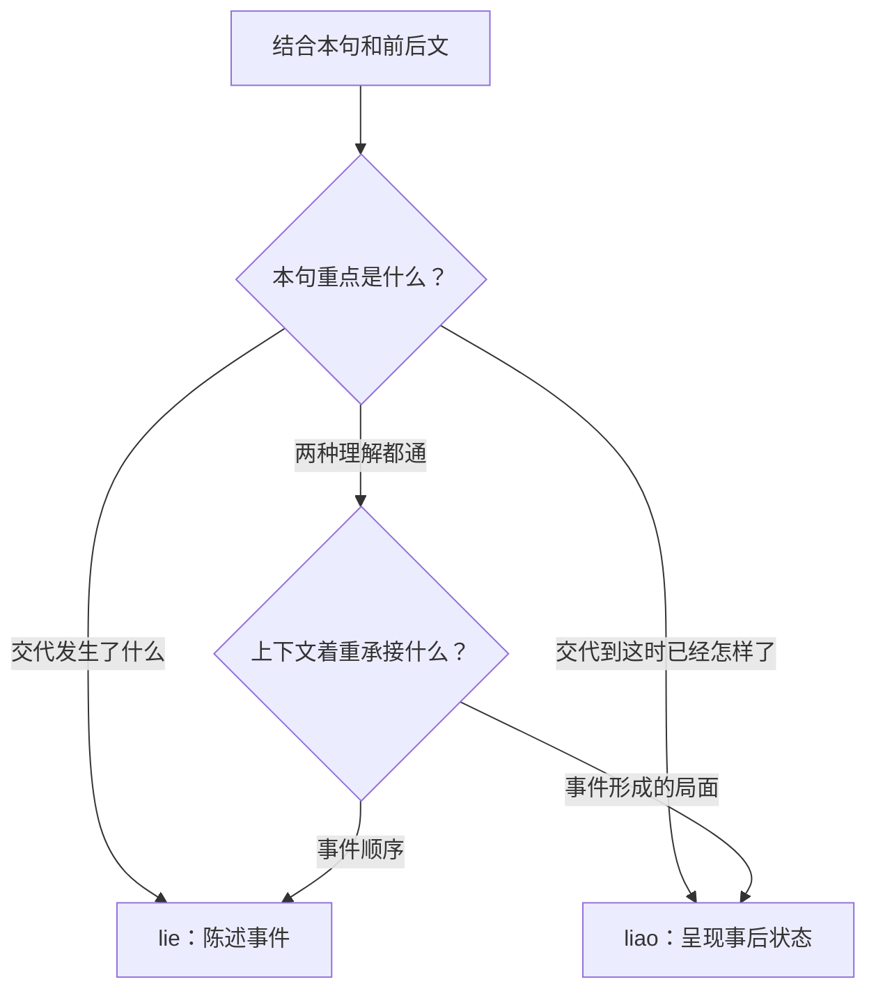
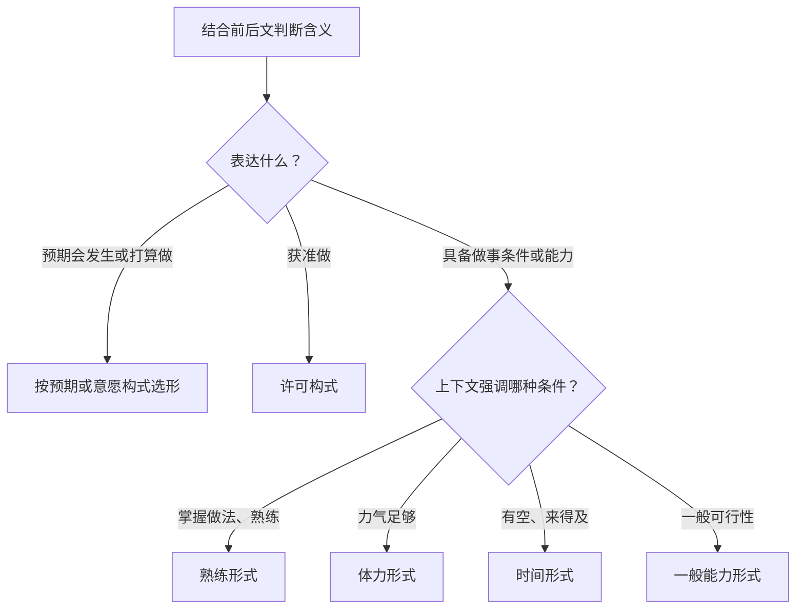
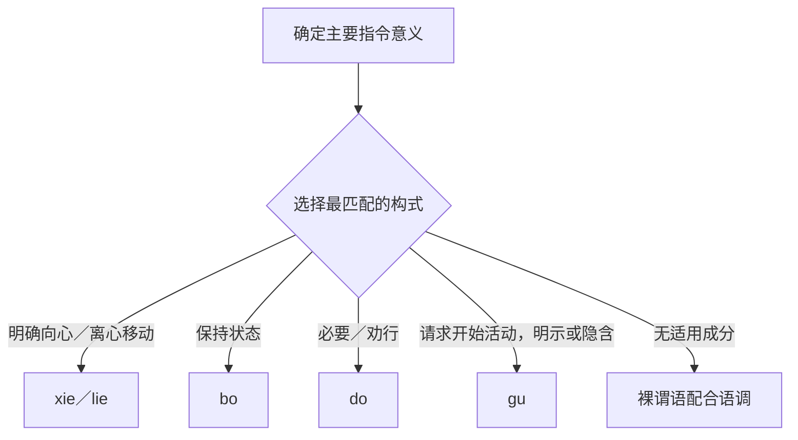

# 翻译结构与选形判断

按具体问题选读；整体分词、否定与gloss标签采用[输出规范](output.md)。

### 复杂句：保留简短从句，拆出较长补充

先标出主句、名词修饰语和补充信息，再组织目标句。一个句子保留一个清楚的从句完全正常；多个从句也可按表达需要保留。从句较多或层层嵌套时，优先保留核心人物或事物的简短修饰语，把较长补充信息拆成后续完整句，沿用清楚的指代。

- **从句按作用范围组织。** 作为“知道、认为、想”等谓语内容的从句，随主句保留其作用范围；条件、原因等关系按对应构式表达。
- **简短修饰语跟着中心名词。** “提水的姐姐进屋”作为一个句子，内部保留“提水的姐姐”。
- **复杂句适度拆解。** “穿旧衣服的人背起阿爸编的背篓，背篓里装着柴”可组织成“穿旧衣服的人背起背篓。背篓是阿爸编的。里面装着柴。”保留人的修饰结构，分别交代背篓的来历和内容。
- **先成句，再排gloss。** 上例三个主句各排一组三行gloss；第一组包含整个“穿旧衣服的人背起背篓”，从句与其中心名词保持在本组。

验收时对照原文检查：简短修饰语保留其依附关系；拆出的补充信息指代明确、意义完整；每个独立主句另组。例子用于说明结构组织，具体土家语词形按本章定语、关系从句和名物化构式选择。

#### lie／mo：先判断动作关系

- **坐着吃饭**：坐是吃饭时的姿势，用“坐＋bo＋mo＋饭＋吃”。
- **笑着走**：笑伴随走，用“笑＋bo＋mo＋走”。
- **洗好再蒸，蒸好后泡一夜**：按步骤用“洗＋lie，蒸；蒸＋lie，泡一夜”。
- **打好糍粑后，分着吃**：前一步用“打糍粑＋lie”，吃的方式用“分＋mo＋吃”。

依据：Brassett等（2006:119，例76；152–154，例25、31–32）。同一主语可以有先后动作，也可以有伴随动作；按两个动作的关系选形。原文已表达原因、条件等其他关系时，按[event linking](event-linking.md)中的对应从句构式组织。

### lie 与 liao：按上下文选择

结合本句和前后文，判断本句是在陈述事件，还是呈现事后状态。

原书直接对照：

- **ga lie**：“吃过了。”——陈述吃过这一事实。
- **ga liao**：“吃过了。”——现在不饿，不必再准备食物。

依据：Brassett等（2006:136），例194–195。以上例句简写助词声调；新译采用所选来源的完整词形与记音。“到这时”可以是说话时，也可以是故事中的参照时点。

#### “会／能／可以”：先判断含义

按[能愿成分表](output.md#modal-components)及[体态情态专题](aspect-modality.md#ability)选择完整形式。否定同样先确定所否定的意义；一句涉及多种条件时，分别表达。例如“织不动”否定体力，“不愿织”否定意愿，二者在下文有不同的否定形式。

**执行时将 gu／do／bo／xie／lie 作为互斥选项，按主要指令意义选一个。** 一般请求开始活动选 gu；这层意义可以明示或由语境隐含。文献固定组合按整例使用，见[祈使与指令](directives.md#combination)。

选定构式后不自行叠加另一选项。接受者用相应论元标记表达；指称清楚时省略第二人称主语。下表提供各分支的例句。

| 指令任务 | 优先形式 | 例子与出处 |
| --- | --- | --- |
| 明示或隐含请求开始活动／现在停止 | V＋gu；禁止用 ta＋V＋gu | “现在把那个给我”“现在别回家”，Brassett 等（2006:135，例191、193）；gu² /ku²⁴/ |
| 保持动作后的状态 | V＋bo | 下方“坐下并坐着”“打开书并保持打开”，Brassett 等（2006:90，例110、112） |
| 带必要性的劝行 | V＋do | 下方“我们走吧”，Brassett 等（2006:90，例113） |
| 物品拿来／拿走 | 拿＋xie／lie（方向） | 向心／离心指令，Brassett 等（2006:119–122） |

**方向由原文或明确语境决定。** 原文要求“拿来／拿走”时分别选向心／离心形式；只有“借给我、给他、请做”等接受者或请求意义时，按接受者关系和祈使语气组织。接受者不是空间方向的证据，方向未明确就保留无方向的谓语，另选适用的祈使成分。例：“给孩子唱首歌”用“孩子＋交谈对象标记＋歌＋唱”的框架；“把篮子拿过来”用“篮子＋拿＋向心”。

gu 的 gloss 用 DIR.IMM；bo 用 STAT，do 按能愿整体成分给出词义，方向成分按 DIR 标注；祈使语气在整句层面标 IMP。

| 原文 | 具体错误例子 | 改法 |
| --- | --- | --- |
| 把消息告诉他们 | 因为“告诉他们”而给“告诉”加xie，额外表达向心移动 | 用“他们＋交谈对象标记＋消息＋告诉”，祈使成分按语气选 |
| 请替她把药煮好 | 将受益者“她”改写成“她的药” | 用“她＋受益者标记＋药＋煮好” |

